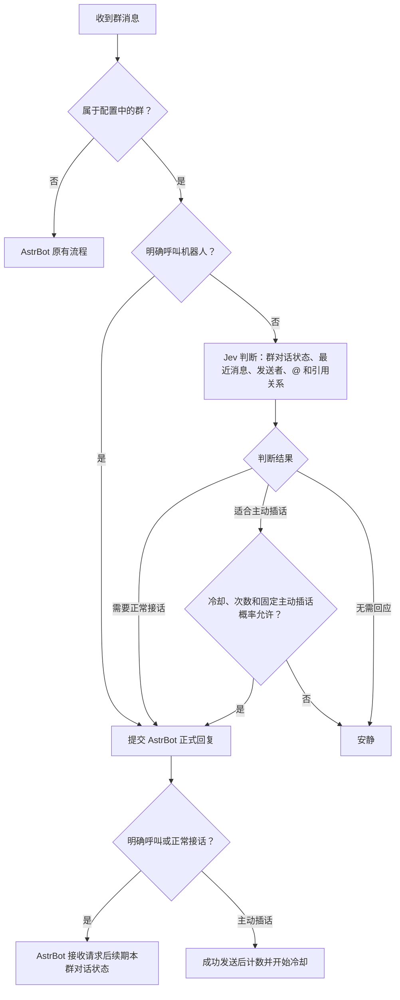

# 小鲸鱼群聊回复门控

用 Jev 判断群消息是否需要机器人回应，正式回复交给 AstrBot。明确呼叫直接进入回复；正常续聊由语义判断；主动插话另外受概率、冷却和次数控制。

## 适用环境

- AstrBot **4.29.3**，通过 `aiocqhttp` 接入 QQ 群聊。
- 支持 Jev **System One** 接口的服务和对应 API Key。
- 聊天模型、人格、工具和长期记忆在 AstrBot 中配置。

依赖固定为 `typesafe-sdk==0.7.5`、`openai==3.37.0`。当前仅声明已验证的 AstrBot 版本。

## 安装和配置

1. 在 AstrBot 的插件管理页面，通过仓库地址安装本插件。
2. 打开插件的“控制面板”，填写接口网址、API Key，点击“获取模型”，选择 Jev 模型并保存。
3. 填写需要启用门控的群号和机器人的称呼。
4. 在这些群使用的 AstrBot 配置中，开启群聊上下文，关闭“群聊上下文感知 → 主动回复”，关闭群内按成员隔离会话。
5. 在群内发送明确呼叫和普通续聊，查看回复及日志。

默认群列表为空，填写后才处理对应群。原生设置页和插件控制面板共用同一份配置。

群号在原生设置中分别添加；控制面板每行一个。下面均为演示号码：

```text
123456789
987654321
```

对应配置格式：

```json
{
  "test_group_ids": ["123456789", "987654321"]
}
```

`test_group_ids` 是群号列表的配置键名。私聊和注册命令仍走 AstrBot 原有流程。

### 接口和模型

默认接口地址是 `https://api.typesafe.ai/v1`，默认模型为 `jev-latest`，也可以填写提供相同接口的网关。

“获取模型”读取 `{API Base}/models`，支持 OpenAI 的 `data[].id` 和 TypeSafe 的 `models[].name`。Jev 判断调用 `/v1/systemone`，所以服务需要同时支持这一接口；仅提供 OpenAI Chat Completions 不满足要求。

模型下拉框只显示接口实际返回的列表，也可以在控制面板手动填写模型 ID。获取列表使用表单中当前填写的连接信息，不会保存其他未提交的编辑。

API Key 默认空白。控制面板不回显已保存的密钥，留空保存表示保留原值；需要清空时，在原生设置中清空并保存。

原生设置中的“获取模型”按钮需要安装[可选前端扩展](extras/native-model-picker/README.md)。使用标准 AstrBot WebUI 时，请在插件控制面板点击该按钮。

## 回复流程



明确呼叫包括真实 @、句首直接呼叫配置中的名字，以及引用机器人消息并附带正文。单纯在第三人称中提到名字，或者 @其他成员，交给 Jev 判断。

Jev 一次请求回答三个问题：

| 字段 | 判断什么 |
| --- | --- |
| `relation` | 对机器人说话、与其他成员交流、面向全群，或交流对象不明确 |
| `response_needed` | 当前消息是否需要机器人继续回应 |
| `interjection_welcome` | 是否适合机器人作一次实质性主动补充 |

关系为 `to_bot`，且关系概率与需要回应程度达到门槛，正常接话；关系为 `open_group`，且关系概率与适合主动插话程度达到门槛，再检查主动插话额度和固定概率。其余保持安静。`confidence` 记录在日志中，不额外设门槛。

要求全体成员各自回复确认的 @全体成员消息，属于对机器人也提出了应答请求，按正常接话判断。普通群通知按内容决定是否需要回应。

群对话状态按“机器人账号＋群号”保存，表示机器人近期参与了讨论。任何成员都能接着聊，状态活跃也不等于每条消息必须回复。明确呼叫和正常接话的正式请求被 AstrBot 接收后续期；主动插话不续期。

同群回复串行处理。回复期间收到的消息合并成下一批判断，保留各消息的发送者。明确呼叫保留呼叫者的原事件。

Jev 使用最近 10 条、3 分钟内、正文和引用约 2000 字的群消息；这些内容会发送到配置的 Jev 服务。正式回复使用 AstrBot 自己的上下文，插件不重复注入 Jev 材料。

## 默认参数

| 设置 | 默认值 |
| --- | --- |
| 门控 / 过程日志 | 开启 / 开启 |
| 启用门控的群号 | 空列表 |
| 机器人称呼 | 小鲸鱼 |
| 本群对话状态有效期 | 120 秒 |
| 固定主动插话概率 | 0.3，即 30% |
| 主动插话冷却 | 20 秒 |
| 每群任意连续 10 分钟内主动插话次数上限 | 10 次 |
| 对她说话的关系门槛 | 0.5 |
| 需要回应门槛 | 0.6 |
| 面向全群的关系门槛 | 0.7 |
| 适合主动插话门槛 | 0.6 |

固定主动插话概率仅作用于主动插话，设为 0 仍会正常接话。冷却和次数按成功发送计算，明确呼叫与正常接话不占额度。

## 日志和排查

在 AstrBot 日志页搜索“小鲸鱼门控”。“记录门控日志”开关控制过程日志，错误日志仍会记录。

| 日志环节 | 含义 |
| --- | --- |
| `received` / `merged` | 收到消息或并入下一批 |
| `judge` | Jev 的关系、概率、判断结果、群状态和耗时 |
| `optional_check` | 主动插话额度和概率检查 |
| `request_reply` / `reply_accepted` | 提交正式请求、框架接受请求 |
| `reply_sent` / `reply_not_sent` | 本轮回复发送结果 |
| `judge_error` | Jev 请求失败 |

过程日志包含消息 ID、机器人 ID、群号、发送者 ID 和判断数据，不记录密钥及聊天正文。分享运行日志前请处理这些身份信息。

缺少密钥时，插件继续加载，控制面板提示待填写。Jev 请求失败时本条普通群消息保持安静，可在日志中排查。

## 开发

| 文件 | 职责 |
| --- | --- |
| `main.py` | AstrBot 事件接入、正式回复和状态更新 |
| `judge.py` | Jev 问题、请求、结果及模型列表 |
| `decision.py` | 判断门槛、主动插话概率、冷却和次数 |
| `presence.py` | 群对话状态、最近消息和消息批次 |
| `settings.py` | 设置接口、模型选项和保存应用 |
| `views/settings/` | 插件控制面板 |
| `tests/` | 离线判断、状态、SDK、设置及 AstrBot 集成测试 |
| `extras/native-model-picker/` | 可选原生设置页按钮扩展 |

普通 Python 环境可运行门控规则和群状态测试，仓库目录名使用 `astrbot_plugin_whale_reply_gate`：

```bash
python -m unittest discover -s tests -p 'test_reply_gate_decision.py' -v
python -m unittest discover -s tests -p 'test_reply_gate_presence.py' -v
```

完整测试在 AstrBot 4.29.3 的 Python 环境中执行，安装本插件 `requirements.txt`，并将 AstrBot 源码根目录加入 `PYTHONPATH`：

```bash
PYTHONPATH=/path/to/AstrBot python -m unittest discover -s tests -p 'test_reply_gate_*.py' -v
```

测试使用离线 HTTP 传输和事件替身，不调用实际模型、不发送 QQ 消息。配置、模型列表缓存由 AstrBot 保存；群对话状态、短期消息和主动插话额度保存在内存中，重载后重新开始。

## 许可证

[GNU AGPL v3](LICENSE)。
